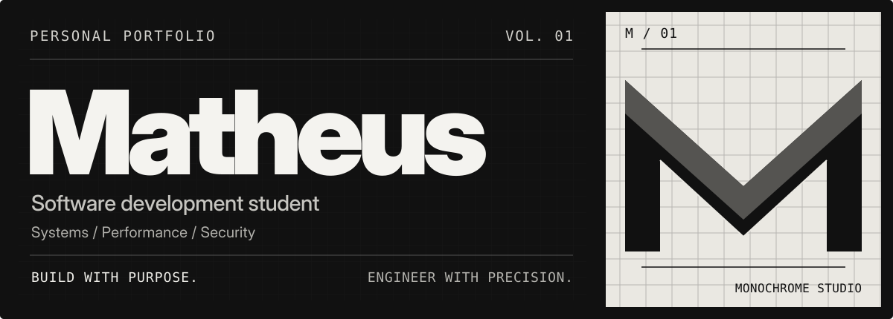
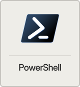
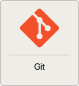
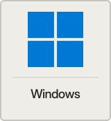
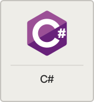
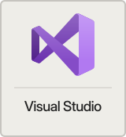
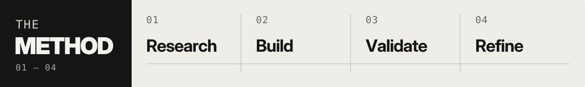

  

## 01 / About

I'm a software development student interested in how systems work beneath the surface. I enjoy writing practical software, understanding operating systems, and building solutions that balance performance, reliability and security.

## 02 / Focus

**Systems & performance** — Windows internals, system behavior and evidence-based optimization.

**Software engineering & security** — maintainable architecture, testing, privacy by design and dependable development.

**Automation & desktop software** — PowerShell workflows, AI-assisted engineering and exploring C#/.NET desktop applications.

## 03 / Toolkit

  
<strong>Working with</strong>

  

    
    
    
    
  

  
<strong>Currently exploring</strong>

  

    
    
    
  

  
C# / .NET / Desktop development with WPF

## 04 / Engineering mindset

  

I believe in understanding the problem first, measuring the result, and improving deliberately. Good engineering should make software easier to trust, maintain and evolve.

---

  Curiosity drives progress. Precision builds trust.

