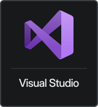

  

## 01 / About

I'm a software development student fascinated by how systems work beneath the surface. I enjoy building practical software, investigating operating system behavior, and making technology more reliable, secure and efficient.

## 02 / Focus

**Systems & performance** — Windows internals, system behavior and evidence-based optimization.

**Software engineering & security** — Maintainable architecture, testing and privacy by design.

**Automation & desktop software** — PowerShell workflows and exploring C#/.NET desktop development.

## 03 / Toolkit

  
<strong>Working with</strong>

  

    
    
    
    
  

  
<strong>Currently exploring</strong>

  

    
    
    
  

  

    C# / .NET / Desktop development with WPF
  

## 04 / Engineering approach

**Research → Build → Validate → Refine**

Understand the problem, implement with care, measure the result and improve deliberately.

Performance, security and maintainability belong together.

## 05 / Contribution Arcade

  

  

    Every contribution counts. Updated daily from GitHub activity.
  

---

  Curiosity drives progress. Precision builds trust.

