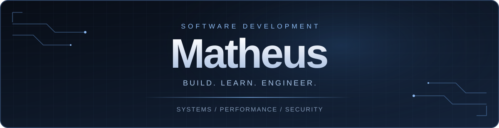

  

 

## About me

I'm a software development student with a passion for building fast, reliable and secure systems. I enjoy understanding how things work under the hood, turning complex problems into practical solutions, and learning through hands-on engineering.

> **Build with purpose. Engineer with precision.**

## Areas of focus

<table>
  <tr>
    <td width="50%" valign="top">
      <h3>01 / Systems &amp; Performance</h3>
      Exploring Windows internals, system behavior, optimization and performance measurement.
    </td>
    <td width="50%" valign="top">
      <h3>02 / Software Engineering</h3>
      Building maintainable solutions with clear architecture, testing and automation.
    </td>
  </tr>
  <tr>
    <td width="50%" valign="top">
      <h3>03 / Security &amp; Reliability</h3>
      Learning secure software development, privacy by design and dependable engineering practices.
    </td>
    <td width="50%" valign="top">
      <h3>04 / AI &amp; Automation</h3>
      Exploring AI-assisted development, technical knowledge management and repeatable workflows.
    </td>
  </tr>
</table>

## Technologies & Tools

**Working with**

 

  

**Currently exploring**

 

 

C# · .NET · Desktop development with WPF

## Engineering mindset

- Understand the problem before writing the solution.
- Measure performance instead of assuming improvements.
- Keep security, stability and maintainability in balance.
- Learn continuously, document decisions and iterate with purpose.

---

  BUILD · LEARN · ENGINEER

