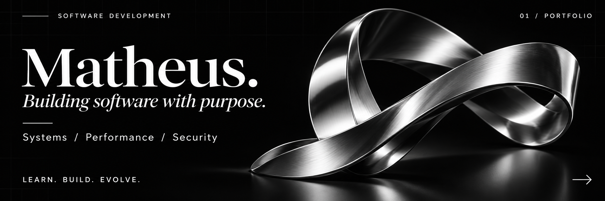
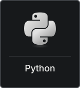
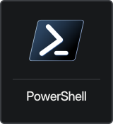
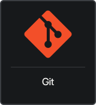
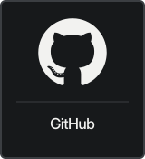
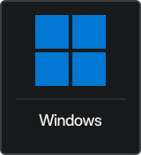
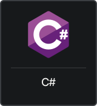

  

## 01 / About

I'm a software development student interested in Windows internals, performance and security. I build small tools and automations, mostly in Python and PowerShell, and I'm learning C# and .NET for desktop development.

## 02 / Focus

**Systems and performance:** how Windows behaves under load, and measuring the effect of a change before keeping it.

**Software and security:** readable code, tests, and careful handling of user data.

**Automation and desktop software:** scripts and tools in Python and PowerShell, and desktop apps with C# and WPF.

## 03 / Toolkit

  
<strong>Working with</strong>

  

    
    
    
    
    
  

  
<strong>Currently exploring</strong>

  

    
    
    
  

  

    C# / .NET / Desktop development with WPF
  

## 04 / Projects

**[MONO / INVADERS](https://github.com/matheuscgxlina/matheuscgxlina)**: a monochrome GitHub contribution calendar rendered as an animated SVG. The renderer is written in Python and runs daily with GitHub Actions.

<!--
Add up to two additional public repositories here when they are ready.
Example (replace the placeholders with a real published repository):
- **[Repository name](PUBLIC_REPOSITORY_URL)** — One concise sentence describing what it does and the technologies used.
Duplicate this item for a third project if needed.
-->

## 05 / Contribution Arcade

  

  

    Generated daily from my GitHub contributions.
  

